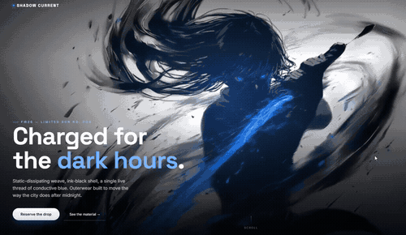

# Shadow Current

A single-page, single-file cinematic landing page built around one hero video — a full-bleed ink-and-electric-blue character loop that reacts to the cursor in real 3D.



## What it does

A full-viewport hero video drives the whole page: a pointer-reactive 3D tilt (real `perspective` + `rotateX/rotateY`, lerped every frame) makes the subject feel like it's leaning out of the screen, with a pulsing energy-glow layer and a slow autonomous drift on touch devices that have no cursor to react to. Below the hero: three liquid-glass feature cards, a glass-bordered CTA band, and a glass footer — all pure CSS (`backdrop-filter` + a gradient-mask border trick, no images).

## Features

- Full-bleed looping hero video with poster-image fallback and intent-based loading
- Real-time cursor-driven 3D tilt on the hero scene, with an autonomous drift fallback for touch
- Liquid-glass UI system (cards, CTA, footer) — translucent panels with a light-catching gradient hairline border
- One-shot entrance choreography (reveal / rise / settle / fade) that cleans up after itself
- Scroll-reveal sections via `IntersectionObserver`
- Navbar that lives only in the hero (not fixed) and gets a solid blurred backdrop once you scroll within it
- Hero video pauses automatically when scrolled out of view (perf)
- Fully responsive: desktop, tablet, phone — burger menu, no horizontal scroll at any width
- `prefers-reduced-motion` support: tilt, drift, and entrance animation all disable cleanly

## Tech stack

Pure HTML/CSS/JS — no build step, no framework, one self-contained `index.html`. Fonts via Google Fonts (Space Grotesk + Inter).

## Run locally

```bash
git clone https://github.com/DexAi3000/shadow-current.git
cd shadow-current
python -m http.server 8080
```

Then open `http://localhost:8080`.
